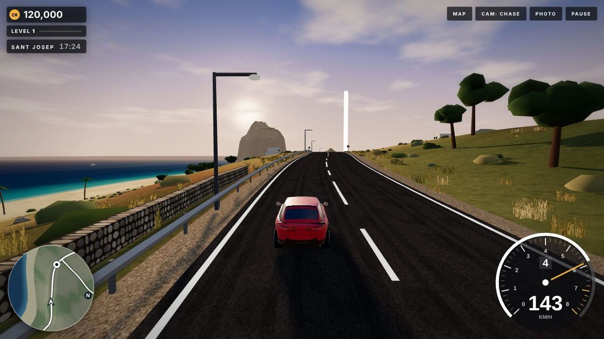

# White Isle Drive

A free-roam driving game set on a Mediterranean island modelled loosely on Ibiza. Cruise the coast roads, buy and collect cars, set records on speed radars, race AI drivers in time trials and races, find the island's landmarks, take on driving contracts and stop for photos. It runs in any modern browser on desktop or phone, with no install and no build step.

### [▶ Play now](https://joyeechuah.github.io/white-isle-drive/)



## Play

**Online:** play it at [joyeechuah.github.io/white-isle-drive](https://joyeechuah.github.io/white-isle-drive/).

**Locally:** download or clone the repository and open `index.html` in Chrome, Edge, Firefox or Safari. It needs an internet connection to load three.js and the web fonts. Browsers block a page opened straight from disk from loading the music files, so locally you'll hear the built-in backup music instead; to hear the full soundtrack, run a small local server in the folder (for example `python -m http.server`) and open `http://localhost:8000`.

## Controls

| Action | Keyboard | Touch |
| --- | --- | --- |
| Accelerate / brake and reverse | `W` / `S` or `↑` / `↓` (holding brake stops the car; press it again to reverse) | GAS / BRAKE pads (slide your thumb between them; BRAKE reads REVERSE once a fresh press will back up) |
| Steer | `A` / `D` or `←` / `→` | ◀ / ▶ pads |
| Handbrake | `Space` | HAND BRAKE pad |
| Interact (dealer, events, house) | `E` or `Enter` | Tap the prompt |
| Map and GPS | `M` | MAP |
| Change camera (remembered next visit) | `C` | CAM |
| Look behind while driving | Hold `B` | Hold REAR |
| Photo mode | `V` | PHOTO |
| Back on the road | `R` | |
| Pause and settings | `Esc` or `P` | PAUSE |

**Game controller:** left stick steers, right trigger is the gas and left trigger the brake (part-way works too), A is the handbrake, X the prompt (E), Y changes camera, hold the left bumper (LB) to look behind, View/Back opens the map, Start pauses and B goes back. In menus, A confirms and the D-pad moves.

Hard impacts transfer speed and damage the vehicles involved, including traffic and race rivals. Damage reduces engine performance, and badly damaged cars smoke. Tap the **DAMAGE** indicator (or choose **VEHICLE CONDITION** from Pause) to see condition and repair choices. **Returning to the garage repairs your car for free**, including via **Go Home** in Pause; returning home ends a current race or contract. When stopped and not racing or test-driving, an optional roadside repair costs **1,000 + 20 × damage percentage** credits (3,000 at 100%) and requires a second confirmation press. Damage warnings appear at 25%, 60%, 90% and 100%. The car stays drivable at full damage. Races start with fresh cars. Damage lasts for the current drive and is not part of your save.

In the garage, `←` / `→` choose a car and `Enter` drives it; CUSTOMISE opens the options for it (`Esc` or controller B cancels, controller A applies). On the map, drag to pan, scroll or pinch to zoom, click a marker to set the GPS or travel there, or click a road to drop a waypoint.

In photo mode, drag (or use the arrow keys) to move around the car and scroll, pinch or press `+` / `−` to move closer. The ZOOM and DISTANCE sliders do the same, `1` to `4` pick a look (AS IS, GOLDEN HOUR, NIGHT DRIVE, COASTAL SUNSET), `R` resets the camera, `Enter` takes the picture and `Esc` or `V` goes back to the game. The world stands still while it's open, and the looks change the light only in photo mode.

The pause menu opens photo mode, the Island Passport, the Contracts board and the Championships board, and sets the time of day, driving assist (keeps the car stable and in its lane), auto gas (off by default, handy on phones), sound effects (SOUND FX), music, graphics quality (AUTO, SHARP or SMOOTH), the time trial ghost, steering sensitivity (STEERING: LOW, NORMAL or HIGH) and, on phones and tablets, TILT STEERING (off by default; the way you hold the phone when you switch it on or resume is straight ahead), and which side traffic keeps to (DRIVE ON: LEFT, the default, or RIGHT, as in Spain). The two sound switches are independent. The garage also has its own MUSIC button.

## Features

- A compact island with the old town of Eivissa, Sant Antoni, hill villages, villas, a coastal highway, offshore islets and passing boats, all generated in code at load time
- A day and night cycle in which the sky, clouds and sea change with the hour, and moonlit nights lit by street lamps and your headlights
- 24 cars from hatchbacks to hypercars across classes A1 to A7, with paint colours, a 12-car garage and a dealership where you can buy, sell and take a 90-second test drive
- Car models built in code from six body types (supercar, GT, hatchback, muscle car, roadster, SUV): smooth curved bodies with wheel arches, clear-coat paint that reflects the sky, panel lines, grilles and intakes, LED lights, multi-spoke rims with brake calipers. Traffic uses a hatchback and a saloon body
- Customise any car you own from the garage (CUSTOMISE): paint finish (metallic, gloss, matte, pearl), a contrast roof, six rim styles in eight colours, brake caliper colours, spoilers, exhaust tips, their finish and a sport exhaust sound, liveries (twin stripes, side stripe or a race number) in six colours, window tint and your own number plate. You see each option on the car as you pick it; the total is paid on APPLY, and paint colour stays free
- 6 events (time trials and races against AI drivers) with medals and personal bests; traffic on the route only drives your way, so you can overtake
- Race difficulty (EASY, NORMAL or HARD) on the race screen: how fast the rivals drive, and rewards of ×0.75, ×1 or ×1.3. Rivals keep their distance, pass slower cars when the other lane is clear and hold back when it isn't
- Class championships: seven cups, A1 to A7, of three events each, entered in a car of the cup's class. Rounds score 10, 6, 4 or 3 points; 22 of 30 wins the cup and a one-time prize from 25,000 CR (A1) to 180,000 CR (A7). Cup time trials have medal times for the class, and cup races put you against cars of the class
- Time trial ghost: your record run comes back as a see-through car on your next attempt, with the live gap to it in the race panel (GHOST CAR in the pause menu turns it off)
- Photo mode: a free camera around your car, a zoom control, three looks (Golden Hour, Night Drive, Coastal Sunset) and a PNG of the scene without the game's on-screen display
- An Island Passport of 18 landmarks to find by driving to them, from the highest road to the far capes and the villages, each paying credits once, with a bonus for finding them all
- Contracts: parcel deliveries, timed courier runs and scenic tours between the towns, with the GPS guiding you and a reward on completion
- Speed radars, plus a free-ride points streak for speed, near misses, oncoming-lane driving and drifts that you bank as credits
- Traffic on the roads, keeping to the left by default or to the right (DRIVE ON in the pause menu), a GPS minimap that draws the route to any marker or waypoint, and a full map with fast travel
- A three-track soundtrack: a Mediterranean lounge groove in the garage and dealership, Balearic house for free driving and a faster track for races, looping without a gap, quieter behind menus and softer after dark
- Engine, tyre, surface and impact sound synthesised live with the Web Audio API
- Responsive HUD for desktop and touch screens in landscape or portrait
- Optional cloud save: play as a guest, or choose SAVE MY PROGRESS to sign in with Google and back up your credits, cars, customisations and achievements, then carry on from another device. A copy always stays in the browser for offline play, the game shows when it last backed up, and if this device and your account have different progress it asks which to keep (see [CLOUD_SETUP.md](CLOUD_SETUP.md))

## How it works

The game itself is one file, `index.html`. The only library is [three.js](https://threejs.org/) r128 (MIT licence), loaded from cdnjs with a Subresource Integrity hash so the browser rejects a modified copy. Terrain, roads, buildings, vegetation, cars, textures and sound effects are all generated procedurally. The only asset files are the three music tracks in `audio/` (about 2 MB each), which are loaded only when needed and looped on the Web Audio clock. Two backup tracks composed in code play if the files can't load. A Content Security Policy in the page only lets it load scripts from itself and cdnjs, fonts from Google Fonts and music from its own folder.

## Testing

The game has an automated test suite that plays it in a real browser (Chromium, through [Playwright](https://playwright.dev/)). Node.js and the packages in `package.json` are only needed to run the tests; the game itself still needs no build or install.

```
npm ci                                  # once: installs Playwright, ESLint and the test copy of three.js
npx playwright install --with-deps chromium   # once: the browser Playwright drives
npm test                                # runs every test (serves this folder on http://127.0.0.1:4173)
npx playwright test tests/contracts.spec.js   # one file
npx playwright test -g "photo"          # tests whose name matches
npm run test:report                     # opens the HTML report of the last run
npm run lint                            # static checks (ESLint) on the game's script
```

`npm start` serves the folder on the same address for playing locally with the full soundtrack.

The tests run against the real `index.html`, read fresh on every run. For tests that need to look inside the game, `tests/support/instrument.js` adds read-only hooks to an in-memory copy; the file on disk is never changed. three.js is served from the npm package (the page's integrity hash is still checked) and web fonts are stubbed, so runs don't depend on outside sites. They cover:

- **Smoke**: the untouched page loads, START, the garage, driving, pause and home; site files and the 404 page.
- **Driving**: throttle, brakes (same at any frame rate), the brake holding the car after a stop and a fresh press reversing, pulling away after braking, gentle corner-assist slowing, steering, handbrake, the sea reset, R to reset, map travel, keys held while menus are open.
- **Garage and dealership**: buying (charged once), not enough credits, the 12-car limit, selling, test drives, paint.
- **Races and time trials**: rewards paid once, checkpoints in order, the finish line, quitting and restarting, no oncoming traffic on any event route, rivals never driving through each other or through traffic, difficulty (pace, rewards, remembered), and the car braking to a stop past the line before the result.
- **Map and GPS**: waypoints and routes, mouse and touch zoom and pan, turning a phone, travelling from a marker.
- **Photo Mode**: where it opens, the world standing still, camera and looks, a real PNG capture, everything restored.
- **Island Passport** and **Contracts**: every landmark and all 9 contracts, each paid once, failures and cancellations.
- **Saves**: reloads, a save from the first release, corrupt and malformed saves, storage being refused.
- **Cloud save** (with a stand-in for Google and Firestore): guests see nothing in the way and download nothing; the first sign-in backs up the guest's progress; another device gets it back; when both differ the player chooses, both ways, and credits are never added together; backups after changes, offline and catching up; another device's newer save isn't overwritten, and the choice waits for the pause menu; signing out; the start screen.
- **Phones**: touch controls, and layouts at six screen sizes (including 360 px tall phones held sideways), and turning the device, the race panel kept clear of the car and the road, the BRAKE / REVERSE label, rolling a thumb from BRAKE onto GAS, and no zooming from a double tap or a pinch.
- **Traffic**: cars keep their distance at junctions, in queues and where they appear, and none waits for good, even behind a parked car.
- **Ghost**: a record run is saved and a slower one isn't, the replay follows the recorded path, is see-through, shows the gap and can't be hit, the switch, and damaged ghosts in a save.
- **Championships**: which cups are open in which car, points, NEXT ROUND, the prize paid once, 22 points to win, quitting a round, class medal times (with the autopilot getting a medal in an A1 and an A7 car), the garage's cups won, and damaged saves.
- **Driving side**: traffic and the car on the left by default, switching to the right at once and after a reload, the mirrored race grid, and ONCOMING points on each side.
- **Controls**: steering sensitivity, a simulated game controller (triggers part-way and fully, stick, buttons) and simulated tilt steering on a phone.
- **Camera**: the chase camera keeps the road ahead in view for small, large and low cars; the chosen camera is remembered.
- **Rendering**: real WebGL drawing by day and night and at each graphics setting.
- **Customise**: options show on the car as you pick them and on the car you drive, APPLY pays the total once and saves it, CANCEL and Escape change nothing, options you can't afford can't be applied, every option builds on every body type, a race number reads the right way on both doors, a damaged customisation save is cleaned and selling a car forgets its customisation.
- **Car models**: every car builds a sound body and glasshouse, paint reaches both, cars of one body type share shapes and textures, and freeing a car keeps what the others share.
- **Stability and performance**: no leftovers after many screen changes, long frame gaps, a hidden tab, memory over a long drive, and measurements of frame cost, GPU load, load time and memory.

GitHub Actions (`.github/workflows/test.yml`) runs ESLint and then the suite on every push to `main` and every pull request. A failing test fails the run, and the HTML report, with screenshots and traces of any failure, is attached to it.

The tests come in two Playwright projects. `chromium` runs the logic and interaction tests with 3D drawing switched off, which is many times faster. `webgl` runs the tests tagged `@webgl`, which draw with real WebGL. Run one with `npx playwright test --project=webgl`.

Limits: on machines without a GPU, CI runners included, Chrome draws with its software renderer (SwiftShader). The rendering tests prove the scene builds and draws, and the performance numbers are comparisons between runs, not frame rates on real devices. Phones are emulated screen sizes with emulated touch in desktop Chromium. Firefox and Safari aren't covered by the automated tests yet.

## Privacy

The game has no ads and no tracking of players. Progress is saved in your own browser's `localStorage` (key `white-isle-drive-v1`); clearing site data resets it; nothing about your progress is sent anywhere unless you sign in (below).

Visits are counted with [Cloudflare Web Analytics](https://www.cloudflare.com/web-analytics/): page views, the country, the browser and device type, the page the visit came from, and how fast the page loaded. It uses no cookies or browser storage and doesn't identify anyone. It only runs on the game's own site, and not at all if your browser sends Global Privacy Control or Do Not Track.

Accounts are optional. If you choose SAVE MY PROGRESS and sign in with Google, the game stores your save, a short summary of it (credits, number of cars, level, landmarks, cups) and the time of each backup in a Firebase (Google) database under your Google user id. Only you can read or write it. Your name and email come from Google for showing who is signed in; they aren't stored in the save. SIGN OUT stops the backups; the copy in your browser stays. The feedback links only open Google Forms or GitHub in a new tab when you click them; the form collects no email addresses.

The page makes two kinds of outside requests: three.js from cdnjs.cloudflare.com and the Barlow fonts from Google Fonts. As with any web font, Google receives the visitor's IP address when the fonts load. To avoid that, delete the three Google Fonts `<link>` lines at the top of `index.html`; the game then uses the system font.

## Music

The soundtrack was generated with Google Flow Music under a Google AI Plus plan: *Mediterranean Showroom* (garage and dealership), *Coastal Cruise Loop* (free driving) and *Island Highway Run* (races and time trials). The backup tracks used when the files can't load are composed in the game's code.

## Feedback

Found a bug or have an idea? I'd love to hear it.

- **[Quick feedback form](https://forms.gle/bPk18BbmhaGLNJtD9)** takes about a minute and needs no account. It's also what **SEND FEEDBACK** in the in-game pause menu opens.
- **[GitHub issues](https://github.com/joyeechuah/white-isle-drive/issues/new/choose)**: if you have a GitHub account, the bug report and idea forms there let you follow the fix.

## How this was made

This game was vibe coded: I directed the design and features, playtested each version, and reported bugs and changes, while the code was written by an AI assistant (Claude by Anthropic). Testing used automated browser checks on desktop and phone screen sizes, plus my own playthroughs in the browser.

## Disclaimer

This is an unofficial, non-commercial fan project. It is not affiliated with, endorsed by or sponsored by any game publisher or car manufacturer. Car makes and model names are trademarks of their respective owners and are used only to identify the vehicles; the car models are simplified original shapes with no logos. The island is a stylised interpretation and not an accurate map of Ibiza.
